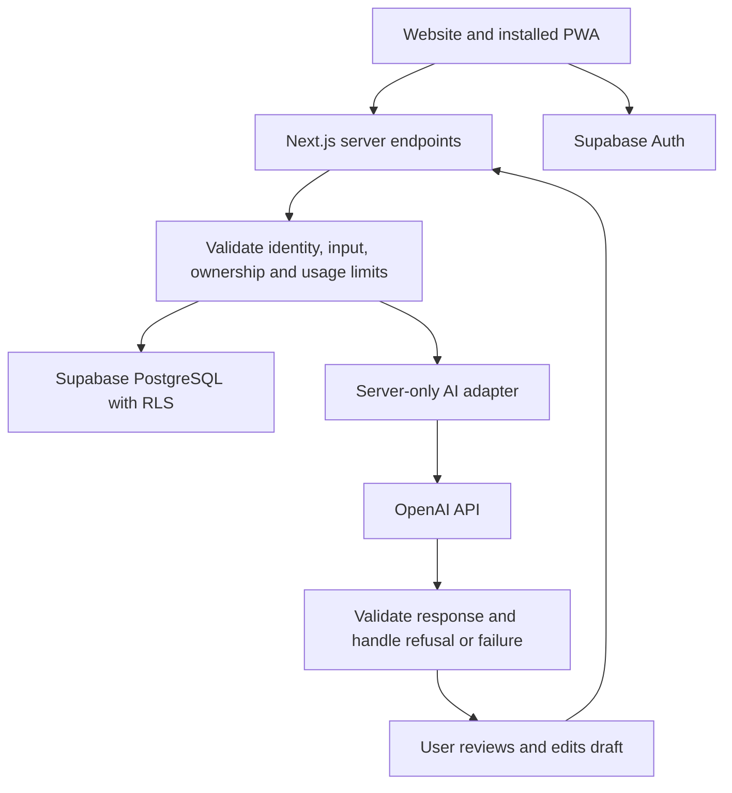

# Rumi: Recommended Tech Stack and Architecture

**Decision date:** November 4, 2026
**Status:** Proposed architecture; not a claim that these features are implemented.
**Product:** Accessible healthcare preparation and communication support for neurodivergent young adults.

## Current repository baseline

As inspected on November 4, 2026, this repository contains a React 18 and TypeScript interactive prototype bundled with esbuild into `dist/index.html`. Its README describes sample data and simulated feature logic. The architecture below is a proposal for further development, not a description of the current implementation.

Preserve the working prototype for the challenge. Introduce backend and AI capabilities incrementally; do not undertake a framework migration solely to match this document before submission. Existing setup and build instructions remain in `README.md`.

## 1. Recommendation

Build **one responsive Next.js application** containing the public website and a mobile-first Progressive Web App (PWA). Use **TypeScript, Tailwind CSS, shadcn/ui, Supabase, and server-side OpenAI API calls**, deployed on **Vercel**.

This is the recommended fit for a small student team with a short challenge deadline. It provides a practical route to a working product without maintaining separate website, mobile, and backend projects. It is not a universal best stack: existing team expertise or a working implementation should take priority over a late rewrite.

A PWA is a website that supported browsers can install on a home screen. It is **not automatically an App Store or Google Play application**. Installation, audio, notifications, and background behavior differ by device and browser. Test on actual target phones. Next.js supports an app manifest and documents the PWA approach. [Next.js PWA guide](https://nextjs.org/docs/app/guides/progressive-web-apps)

## 2. Stack at a glance

| Layer | Choice | Role in Rumi |
| --- | --- | --- |
| Website and application | Next.js App Router + React + TypeScript | Public pages, preparation flow, practice interface, server endpoints |
| Styling | Tailwind CSS | Consistent responsive layouts, themes, and reduced-motion styles |
| UI components | shadcn/ui | Editable component starting points; accessibility still requires testing |
| Validation | Zod | Validate form input and AI response structures |
| UI state | React state and context initially | Current step, preferences, practice controls; avoid unnecessary state libraries |
| Backend | Next.js Route Handlers on the Node.js runtime | Authentication checks, AI calls, request limits, input validation |
| Database | Supabase PostgreSQL | User-owned appointments, preparation cards, preferences, reflections |
| Authentication | Supabase Auth | Account access; a separate synthetic-data demo can work without sign-up |
| Authorization | PostgreSQL Row Level Security (RLS) | Restrict each user's records to their authorized access |
| AI | Official OpenAI JavaScript SDK, Responses API, Structured Outputs | Editable preparation cards, wording help, bounded practice turns |
| Voice, after text works | Browser audio capture + server transcription; optional text-to-speech | Alternative input/output with complete text fallback |
| Deployment | Vercel | Next.js deployment and previews |
| Testing | Vitest, Playwright, @axe-core/playwright | Logic checks, complete user journeys, automated accessibility checks |
| Collaboration | GitHub + GitHub Actions | Pull requests, reproducible builds, review, automated checks |
| Package management | pnpm | One committed lockfile and consistent team installs |

Use mutually compatible stable releases at setup, pin the runtime and package-manager versions, and commit `pnpm-lock.yaml`. Do not guess package versions from this document or upgrade major versions during the final demo sprint.

References: [shadcn/ui with Next.js](https://ui.shadcn.com/docs/installation/next), [Supabase Auth](https://supabase.com/docs/guides/auth), [Vercel Next.js deployment](https://vercel.com/docs/frameworks/full-stack/nextjs).

## 3. Scope the stack should serve

### First release

1. Enter an already-booked appointment and choose one personal goal.
2. Type concerns and generate an editable preparation card.
3. Add communication preferences and requested accommodations.
4. Practice one short appointment scenario with pause, repeat, and notes.
5. Use **Help Me Say It** to rephrase the user's own message.
6. View or print the approved card for the real appointment.
7. Reflect on whether the user communicated what mattered and received requested support.

Keep one appointment-related unexpected-change scenario if the core flow is reliable. Build a usable text experience before voice or avatars.

### Later releases

| Capability | Extension path | Dependency before release |
| --- | --- | --- |
| Native iOS/Android apps | Expo + React Native, sharing API contracts and TypeScript schemas | Evidence that native capabilities or store distribution are needed |
| Appointment audio summaries | Private object storage, transcription, background job worker | Consent, retention, deletion, source-grounding, and error-review workflow |
| Rumi Circles | Supabase-backed membership and messaging; Realtime when needed | Reporting, blocking, human moderation, and operational ownership |
| Scheduling integrations | Provider-specific server integrations | Actual partner/API access and booking confirmation |
| Visual learning | Reviewed instructional content before generated video | User testing and factual review of content |
| Daily planning and Money Mirror | Additional modules using the same account and database | Validation that these solve priority user needs |

Expo supports native and web development, but Next.js DOM components and shadcn/ui screens will not simply become native screens. Share business logic and schemas; budget for native UI work. [Expo tutorial](https://docs.expo.dev/tutorial/introduction/)

## 4. Architecture



The server must derive identity from the verified session, never from a client-supplied `user_id`. Use a user-scoped Supabase client so RLS remains active. Keep privileged administrative credentials out of routine application requests.

Protect every mutation, including ownership checks for supplied appointment IDs. Apply request-size limits, timeouts, and shared rate limits before exposing AI endpoints publicly. An in-memory counter is insufficient across serverless instances.

Do not add a separate Express server, Python service, vector database, or agent framework for the first release. Rumi's initial workflow needs structured input, controlled AI generation, and user review; it does not require autonomous agents or document retrieval.

## 5. AI implementation

Use a small server-only adapter with three operations:

```ts
generatePreparationCard(input)
suggestUserWording(input)
generatePracticeTurn(input)
```

Use Structured Outputs for predictable response fields, then validate application rules. Schema compliance does not establish factual correctness. Handle refusals, incomplete responses, timeouts, and invalid output without deleting user input. [Structured Outputs](https://developers.openai.com/api/docs/guides/structured-outputs)

Keep the model configurable through `OPENAI_TEXT_MODEL`. Before locking a model, compare available structured-output-capable models using the same synthetic examples. Select the lowest-cost model that meets the team's meaning-preservation and latency targets; document the actual model ID and results. This proposal intentionally does not claim an untested model is best.

### Output contract

- Keep `original_user_text` separate from suggested wording.
- Separate reported concerns, suggested questions, and requested accommodations.
- Never add symptoms, medical history, diagnoses, or treatment instructions.
- Let users accept, edit, or discard every generated draft.
- Keep practice clearly labeled as a simulation.
- Return one practice question at a time; pause and replay are deterministic UI actions.
- Preserve helpful text when AI is unavailable; the card must remain manually editable.
- Version prompts in the repository and evaluate changes against fixed synthetic examples.

No fine-tuning or long-term AI memory is needed initially. Send only context required for the active operation. Use `store: false` where supported, but do not describe that setting as zero retention: provider logging and endpoint-specific retention are separate considerations. [OpenAI data controls](https://developers.openai.com/api/docs/guides/your-data)

## 6. Data and sharing

Suggested initial tables:

| Table | Purpose |
| --- | --- |
| `profiles` | User ID, display name, communication and display preferences |
| `appointments` | Owner ID, date/time/timezone, optional provider, user-selected goal |
| `preparation_cards` | Owner and appointment IDs, original input, editable draft, approved version |
| `reflections` | Owner and appointment IDs, optional feedback about participation and support |

Practice conversation can remain session-only unless the user explicitly chooses to save it. Store timezone information with appointment scheduling data.

Enable RLS on every user-owned table. Cover reads, inserts, updates, and deletes; use both access predicates and write checks. Ensure a child record cannot reference another user's appointment through relational constraints or policy checks. Test with two independent users. [Supabase RLS](https://supabase.com/docs/guides/database/postgres/row-level-security)

Start with a print-friendly card and browser print/save-to-PDF. Preview exactly what is included. A downloaded or printed copy cannot be revoked remotely. Add authenticated, revocable supporter access only when the recipient authorization and consent model are implemented.

Use private buckets and storage policies if uploads are introduced. Avoid public URLs for sensitive files. [Supabase Storage access control](https://supabase.com/docs/guides/storage/security/access-control)

## 7. Voice, accessibility, and offline behavior

- Keep every core action available through text and keyboard.
- Offer optional push-to-talk with explicit microphone controls; check supported recording formats on each target browser.
- Let users review transcribed text before it becomes their input.
- Add optional read-aloud with stop, repeat, and speed controls. Clearly identify generated voices. [OpenAI text-to-speech](https://developers.openai.com/api/docs/guides/text-to-speech)
- Use visible focus, properly labeled fields, readable contrast, adjustable text, and reduced motion.
- Avoid autoplay, forced response countdowns, and evaluation of eye contact or typical speech patterns.
- Announce completed AI turns accessibly rather than announcing every streamed token.
- Treat component libraries and automated scans as aids; manually test keyboard use, zoom, and screen readers.

For the first PWA, cache only public static assets and an offline explanation. Do not cache authenticated pages, AI responses, appointment records, or API traffic in the service worker. Explicitly prevent sensitive response caching on the server/CDN as well. Installation does not make AI available offline. A user-exported card provides a practical offline option.

## 8. Repository layout

```text
src/
  app/
    (marketing)/page.tsx
    (product)/appointments/
    (product)/practice/
    api/preparation/route.ts
    api/wording/route.ts
    api/practice/route.ts
    manifest.ts
  components/
    ui/
    preparation/
    practice/
  lib/
    ai/                 # Server-only adapter and prompt loading
    schemas/            # Input/output validation
    supabase/           # Separate browser and server clients
    authorization/
prompts/
supabase/migrations/
tests/unit/
tests/e2e/
tests/ai-fixtures/       # Synthetic examples only
public/
.env.example
TECH_STACK.md
README.md
```

Suggested configuration names:

```dotenv
NEXT_PUBLIC_SUPABASE_URL=
NEXT_PUBLIC_SUPABASE_PUBLISHABLE_KEY=
OPENAI_API_KEY=
OPENAI_TEXT_MODEL=
```

Only Supabase's public project configuration belongs in `NEXT_PUBLIC_*` variables. AI keys and administrative secrets must remain server-only. Commit placeholders in `.env.example`; ignore populated environment files. Public Supabase keys require correctly configured authorization policies.

## 9. Delivery and verification

### Build order

1. Deploy the shell and public website; establish a reproducible build.
2. Complete the manually editable appointment card and print view.
3. Add AI preparation and wording assistance with user approval.
4. Add one practice scenario and failure fallbacks.
5. Add account persistence with tested RLS, or keep an explicitly synthetic-data demo.
6. Test the full journey on a phone, desktop, and keyboard before expanding features.

With the November 5 submission deadline, prioritize a complete healthcare journey. A simulated integration must be labeled; a clickable placeholder must not be presented as working functionality.

### Required checks

- Typecheck, lint, and production build in GitHub Actions.
- Unit checks for validation and approved-card state changes.
- Two-user database tests proving isolation and preventing cross-user child records.
- Playwright journey: enter concerns, edit generated card, practice, print, and return.
- Failure checks: AI timeout/refusal, expired session, network loss, and denied microphone access.
- Automated accessibility checks plus manual interaction review. [Playwright accessibility testing](https://playwright.dev/docs/accessibility-testing)
- AI examples checking invented symptoms, changed meaning, excessive response length, and inappropriate medical advice.

Use synthetic data in public demos and preview deployments. Keep health content out of application logs, analytics events, error reports, and GitHub issues. Restrict production access and define deletion/retention behavior before inviting users to enter real health information. Vendor selection alone does not establish healthcare compliance.

## 10. Cost and future decisions

Budget separately for hosting, database/storage, AI text, transcription, and speech generation. Free tiers or student offers may help but are not guaranteed to cover the product. Check current account limits and terms before deployment; this document makes no fixed-price claim.

Control usage through short practice sessions, output limits, user quotas, concurrency limits, and spend monitoring. Add a shared database-backed usage counter with atomic updates before a public AI demo. Add a managed Redis service only if traffic justifies it.

Choose Expo later if native capabilities become a real requirement. Add a background job service before processing long recordings; do not assume a short web request can reliably handle an entire appointment. Expand community features only with the people and workflows needed to operate them.

**Architecture decision:** Next.js + TypeScript + Tailwind CSS + shadcn/ui + Supabase + server-side OpenAI, deployed on Vercel, with a PWA first and native apps as a later evidence-based decision.
